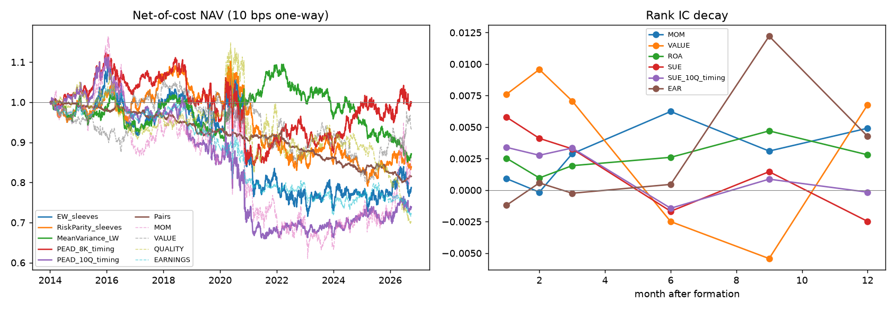

# Equity research with alternative data: S&P 500, 2014–2026

A cross-sectional equity research pipeline built on free data. It covers point-in-time universe and price onboarding with quality checks, an earnings-surprise signal dated at the SEC 8-K press release, and factor evaluation (IC, decay, turnover, quantiles). It also runs a cointegrated-pairs book and three portfolio constructions (equal weight, risk parity, Ledoit-Wolf mean-variance with market and sector neutrality), all walk-forward and net of costs.

One command reproduces everything (`uv run altdata`, about 5 minutes on a laptop once the data is cached). Every number below comes from `results/`.

**Short version.** Over 2014–2026, in S&P 500 stocks, the classic monthly factors have no edge after costs. The best monthly rank IC is earnings yield at 0.012 (t = 1.5), and every combined book has a negative net Sharpe. The earnings signal tells a sharper story. Stocks in the top SUE quintile beat the bottom quintile by **1.54% over the 60 trading days after the release (t = 3.2)** when traded off the 8-K, against **1.19% (t = 2.4)** when the strategy waits for the 10-Q XBRL. The event-driven book traded off the 8-K has a gross Sharpe of **0.45**, twice the 0.20 of the same book traded off the 10-Q. After 10 bps per trade, that shrinks to **0.04**, with no alpha left once momentum is controlled for. The early timing is real, but it isn't enough to pay for trading large caps.

## Results

### 1. Data onboarding

| | |
|---|---|
| Universe | S&P 500 point-in-time membership, rebuilt from a pinned Wikipedia revision (index changes walked backwards); 505 / 508 / 506 / 503 members on 2014-01-02 / 2018-01-02 / 2022-01-03 / 2026-06-30 |
| Tickers ever in the index since 2013 | 769 |
| Tickers with Yahoo prices | 616; 22 dropped as **recycled symbols** (Yahoo history starts after the index member left, so it is another company: ADT, EMC, STI, …) |
| Member-days with a usable price | **87.0%** overall: 73.4% in 2013, 87.5% in 2019, 98.6% in 2026 |
| Survivorship gap | Of 266 names removed from the index, only **36.1%** have Yahoo data (current members: 99.0%). Acquired and bankrupt names are mostly missing |
| Cleaning | 2,958 stale stock-days masked (≥5 identical closes, e.g. AMCR and SW padded with a flat price before listing); 92 moves over 50% with no split kept; the ones I spot-checked were real events (trial results, spin-offs, GME) |
| SEC EDGAR | 604 companies with XBRL company facts; 27,555 quarterly EPS events since 2013; **98.7%** matched to an 8-K Item 2.02 earnings release |
| Release → 10-Q lag | median 4 calendar days, mean 14.7 (fiscal Q4: the 10-K often comes weeks later) |
| LLM cross-check | On 224 releases where the llama3-finreport-extraction QLoRA model's test set overlaps this universe, its extracted diluted EPS matches the first-filed XBRL EPS to within half a cent in **95.1%** of cases |
| Signal coverage (share of universe-months) | momentum 99.5%, book/market 84.6%, earnings yield 83.5%, ROA 85.9%, SUE 91.3% |

### 2. Earnings event study (20,614 releases, 51 quarters)

Market-adjusted log return (%) by SUE quintile; quintiles are formed within each calendar quarter.

| SUE quintile | reaction d−1 → d+1 | 8-K → 10-Q gap | drift, 60d after 8-K | drift, 60d after 10-Q |
|---|---|---|---|---|
| Q1 (worst surprise) | −1.25 | −0.24 | −1.74 | −1.62 |
| Q3 | −0.05 | −0.15 | −1.24 | −1.42 |
| Q5 (best surprise) | +0.56 | −0.00 | −0.48 | −0.73 |
| **Q5 − Q1** | **+1.79** | +0.23 | **+1.54** | **+1.19** |
| t-stat (across quarters) | 12.8 | 2.0 | 3.2 | 2.4 |

All quintiles drift below SPY because the equal-weighted S&P 500 lagged the cap-weighted index over this period, so only the spread matters. SUE sorts the release-day reaction very strongly, and drift continues for months. Waiting for the 10-Q costs about a quarter of the 60-day spread.

### 3. Monthly signal evaluation (152 months, about 400–445 names per month)

Signals are rank-normalised and demeaned within Fama-French-12 industries.

| signal | rank IC | t | ICIR (ann.) | Q5−Q1 % / yr | top-quintile turnover / month |
|---|---|---|---|---|---|
| Momentum 12-1 | 0.001 | 0.06 | 0.02 | 1.5 | 24% |
| 1-month reversal | 0.005 | 0.42 | 0.12 | −0.4 | 76% |
| Low volatility | −0.000 | −0.02 | −0.01 | −4.0 | 8% |
| Book / market | 0.003 | 0.30 | 0.08 | 2.3 | 24% |
| Earnings yield (TTM) | **0.012** | 1.47 | 0.41 | 2.4 | 26% |
| ROA (quality) | 0.003 | 0.26 | 0.07 | −0.5 | 6% |
| SUE, 8-K timing | 0.006 | 0.90 | 0.25 | 1.1 | 27% |
| SUE, 10-Q timing | 0.003 | 0.55 | 0.15 | 0.7 | 27% |
| Announcement return (EAR) | −0.001 | −0.20 | −0.06 | −1.5 | 32% |
| Composite (MOM, VALUE, QUALITY, EARNINGS) | 0.007 | 0.65 | 0.18 | 0.6 | 27% |

The IC decay, sub-period ICs and quintile returns are in [`results/RESULTS.md`](results/RESULTS.md). Nothing is significant at the monthly horizon. The signals behave as designed, though: the momentum sleeve loads 0.69 on Fama-French UMD (t = 34, R² 0.81), value loads on HML (+0.11) and quality on RMW (+0.26).

### 4. Portfolios (net of 10 bps one-way and 30 bps/yr short borrow; Jan 2014 – Sep 2026)

| portfolio | Sharpe gross | **Sharpe net** | return net %/yr | vol % | max DD % | turnover ×/yr | FF5+Mom alpha %/yr (t) |
|---|---|---|---|---|---|---|---|
| Equal-weight sleeves | 0.01 | −0.14 | −1.4 | 10.0 | −34.5 | 12.3 | −3.3 (−2.2) |
| Risk parity (ERC) sleeves, Ledoit-Wolf | 0.07 | −0.18 | −1.2 | 6.4 | −28.3 | 13.2 | −2.1 (−1.4) |
| Mean-variance, Ledoit-Wolf, β- and sector-neutral | 0.06 | −0.18 | −1.0 | 5.3 | −22.2 | 9.9 | −2.0 (−1.5) |
| **PEAD, 8-K timing** | **0.45** | **0.04** | 0.4 | 8.4 | −25.0 | 30.9 | −0.5 (−0.3) |
| PEAD, 10-Q timing | 0.20 | −0.24 | −2.0 | 8.4 | −40.7 | 33.9 | −2.8 (−1.7) |
| Pairs (Engle-Granger) | −0.06 | −0.87 | −1.6 | 1.8 | −20.7 | n/a | n/a |

Net Sharpe as a function of the one-way cost:

| | 0 bps | 5 bps | 10 bps | 20 bps |
|---|---|---|---|---|
| Mean-variance LW | 0.01 | −0.09 | −0.18 | −0.37 |
| Risk parity sleeves | 0.02 | −0.08 | −0.18 | −0.39 |
| PEAD, 8-K timing | 0.41 | 0.23 | 0.04 | −0.33 |
| PEAD, 10-Q timing | 0.16 | −0.04 | −0.24 | −0.65 |

The mean-variance book holds about 207 names at gross 2.0, with average Ledoit-Wolf shrinkage of 0.07 and ex-ante volatility of 2.9%. Realised volatility was 5.3%, so the sample covariance understates risk even after shrinkage. Risk parity's sleeve weights averaged 39% value, 26% earnings, 22% quality and 13% momentum. The PEAD books load on momentum (0.28, t ≈ 11), and once that and the other Fama-French factors are controlled for, the 8-K book's alpha is about zero.

### 5. Pairs trading (26 walk-forward windows, 512 pairs)

* Formation: 252 days. Pairs come from the same FF-12 industry; the 20 lowest-SSD candidates per industry are Engle-Granger tested, keeping p < 0.05 and at most 20 pairs per window.
* Trading: the next 126 days. Enter at |z| > 2, exit at |z| < 0.5, stop at |z| > 4, with one-day execution delay and 10 bps per leg.
* 1,889 round trips; 97.7% of pairs trade at least once, and 39.6% of traded pairs make money net.
* **Only 7.6% of selected pairs are still cointegrated (p < 0.05) over their trading window.** Formation-period cointegration among large caps mostly does not persist, which is why the gross Sharpe is about zero. Average capital in use is 37.7%, so returns are small in both directions.



## What this means

* **Onboarding is where most of the work went, and where the bias is.** Free data loses a quarter of the 2013 universe, mostly names that were later acquired or went bust. The backtests therefore run on a universe that is too clean in the early years. The coverage table makes the size of the gap explicit rather than hiding it.
* **The alternative-data timing has measurable value.** The same EPS number, dated at the press release instead of the XBRL filing, doubles the gross Sharpe of the drift strategy (0.20 → 0.45) and raises the 60-day spread from 1.19% to 1.54%. That is the case for reading releases with an extraction model (here, a QLoRA Llama 3.1 8B) rather than waiting for structured filings.
* **It does not survive costs in large caps.** Re-equalising the event book daily means about 31× annual turnover, and at 10 bps per trade that consumes almost all of the gross return. A fixed-size-per-event book would trade less; I haven't tested it.
* **Monthly factors in mega-caps, 2014–2026: nothing.** Momentum, value, quality and low-vol all have ICs indistinguishable from zero, and better construction (risk parity, shrinkage, neutrality constraints) only lowers volatility and drawdown. No construction method creates an edge that the inputs lack.

## Method

### Point-in-time rules (tested in `tests/test_no_lookahead.py`)

* **Universe:** a stock is in the universe at rebalance *t* only if it is an index member on *t* (reconstructed membership) and had a price on *t−1*.
* **Prices:** signals at *t* use closes through *t−1*. Trades happen at the close of *t* and earn returns from *t+1*.
* **Filings:** a value is usable only if its filing date is strictly before *t*. For each fiscal period the first-filed value is kept, so later restatements are ignored. A late-filed amendment for an older period never overwrites a newer period.
* **Fiscal Q4** is derived as the annual value minus the three reported quarters, and becomes available with the 10-K.
* **Market cap** = Yahoo split-adjusted close × reported diluted share count × splits after the filing date. Yahoo applies later splits retroactively, and the split factor undoes exactly that.
* **SUE** = (EPS_q − EPS_q−4) / std of the previous 8 seasonal differences (minimum 4). The scale never includes the current quarter. The signal is live for 95 days after the release.
* **PEAD book:** an event enters at the close of the trading day after the 8-K (or 10-Q). Long and short legs are cut at the 80th and 20th percentiles of SUE over the previous 365 days of events, strictly before. Positions are held for 60 trading days.
* **Pairs:** hedge ratio and spread mean/std are frozen at the end of formation. A z-score crossing seen at the close of day *d* is traded at the close of *d+1*.
* **Risk parity** uses sleeve returns through *t−1*. The mean-variance model uses 252 days of returns ending *t−1*.

The tests perturb all data from *t* onwards (prices × U(0.5, 2), later filings × 7) and assert that signals and positions at *t* are unchanged. Each test also checks that the perturbation does change later values, so it can't pass vacuously.

### Why XBRL values instead of running the LLM

Extracting EPS from about 27,000 press releases with an 8B model would take roughly 120 hours on an M4 Pro (15.9 s per document in the finreport project). The same figure is available as structured XBRL a few days to weeks later. So the pipeline takes the first-filed XBRL EPS and dates it at the 8-K release. That is what a perfect extractor would return on release day.

The cross-check above shows the real QLoRA model gets within half a cent of that figure 95.1% of the time, so the gap between the oracle and the model is small. Plugging model predictions in instead of XBRL values only needs a different `val` column in `earnings.release_dates`. Guidance and tone extraction would need the full text and is not done.

### Factors and portfolios

* **Sleeves:** MOM (12-1), VALUE (mean of book/market and TTM earnings-yield z-scores), QUALITY (TTM ROA), EARNINGS (mean of SUE and announcement-return z-scores). Each sleeve holds long-short weights proportional to the sector-demeaned score, at gross 2.
* **Risk parity:** equal risk contribution across the four sleeves, using a Ledoit-Wolf covariance of their trailing 252 daily returns. It is solved as the convex problem min ½yᵀΣy − mean(log y).
* **Mean-variance:** maximise αᵀw − λwᵀΣw − c‖w − w_prev‖₁ subject to Σw = 0, βᵀw = 0, every FF-12 sector summing to zero, |wᵢ| ≤ 2% and ‖w‖₁ ≤ 2. Here α = IC·σ·z (Grinold, with an assumed IC of 0.03) and Σ is Ledoit-Wolf in factored form. It is solved with CLARABEL via cvxpy, 153 monthly solves, all optimal.
* **Backtest:** buy-and-hold within each month on daily prices, so weights drift. Costs are charged on traded notional against the drifted book; a stock that stops trading is carried at its last price.
* **Exposures:** daily net returns regressed on Fama-French 5 factors + momentum, with Newey-West (5 lags) t-stats.

Every parameter is in `src/altdata/config.py` and was fixed before running the backtests. Nothing was tuned on results. One exception: the PEAD event book was added after the monthly results showed that monthly rebalancing dilutes an event signal. It uses the textbook specification (quintiles, 60-day hold), not optimised values, but it is not a clean out-of-sample test.

## Limits

* **Survivorship:** 13% of member-days lack prices, heavily concentrated in names that left the index (only 36% of them have data), and delisting returns are missing. The effect on long-short results is ambiguous in sign: the missing names were probably mostly short candidates for momentum and quality, and long candidates for value.
* **Index membership:** depends on Wikipedia's change table (9 inconsistent rows). It is held fixed after the 2026-06-30 snapshot, which is stale but never forward-looking.
* **Industries:** FF-12 from current SEC SIC codes, not point-in-time.
* **Costs:** a flat 10 bps one-way plus 30 bps/yr borrow, with no market impact model. That is reasonable for S&P 500 names at small size and optimistic for large size.
* **Fundamentals:** basic only (equity, assets, net income, EPS, diluted shares). There is no gross profit, accruals or analyst consensus. SUE uses a seasonal random walk, not consensus surprise, and consensus data is not free.
* **Sharpe ratios** are computed without subtracting a risk-free rate: the books are dollar-neutral, and the cash they would earn is ignored.

## Running it

```bash
uv sync
```

```bash
uv run pytest -q
```

```bash
uv run altdata
```

* **First run:** downloads Yahoo prices (about 1 minute), the pinned Wikipedia page, Fama-French factors, and SEC EDGAR company facts and submissions for about 600 companies.
* **SEC access:** 8 requests/second with a declared User-Agent. Set `SEC_USER_AGENT="Name email"`, as the SEC fair-access policy asks.
* **Caching:** EDGAR responses are gzip-cached in `data/`, which is git-ignored. If `~/Projects/llama3-finreport-extraction/data/cache` exists (override with `EDGAR_SEED_CACHE`), it is read first, so files already fetched are not requested again.
* **Runtime:** later runs take about 5 minutes on CPU.
* **Why no cloud:** the whole study is a few hundred MB of panel data and convex solves of about 500 variables; nothing here needs a GPU or cloud.

Seeds are fixed (`config.SEED`); the pipeline itself is deterministic.

```
src/altdata/
  universe.py      point-in-time S&P 500 membership from Wikipedia changes
  prices.py        Yahoo download + split handling
  quality.py       recycled tickers, stale prices, jumps, coverage report
  edgar.py         rate-limited, cached SEC client (from llama3-finreport-extraction)
  fundamentals.py  XBRL company facts -> first-filed, point-in-time panels
  earnings.py      SUE, 8-K release dates, event study, PEAD book, LLM cross-check
  factors.py       signals, sector neutralisation
  evaluation.py    IC / rank IC, decay, turnover, quantile spreads
  pairs.py         Engle-Granger pairs, walk-forward
  portfolio.py     backtest, Ledoit-Wolf, risk parity, mean-variance, FF regressions
  pipeline.py      end to end -> results/
```
